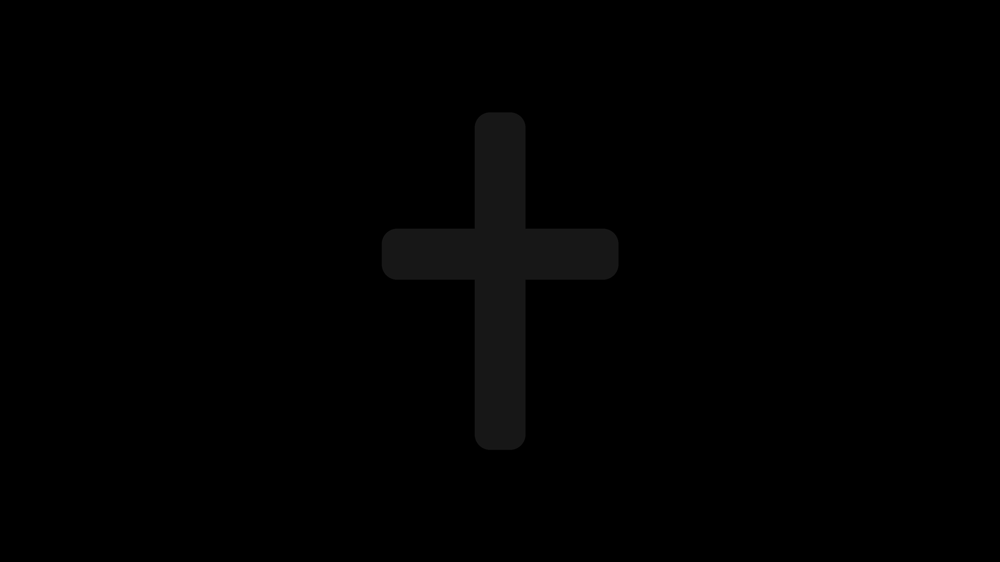
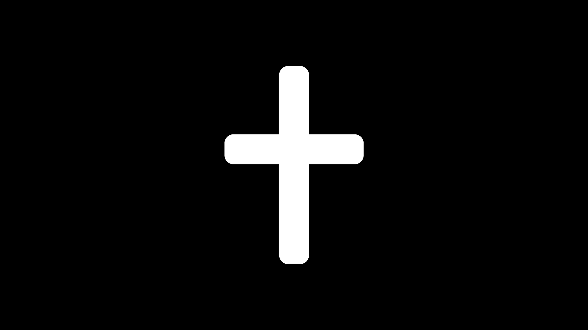

# crosswall

A tiny, burn-in-aware wallpaper generator that draws a Christian cross on a pure
black background for your laptop and desktop screens. Built for people who leave
their screens on 24/7 and still want something beautiful and meaningful on them.




## Features

- Pure black `(0, 0, 0)` background — the safest possible base for any panel
- Centered, antialiased Latin cross with rounded beams
- **Burn-in-smart colors**: the default `safe` style renders the cross at under
  1% luminance, which ages OLED pixels at a negligible rate even 24/7
- Panel-aware: `--panel oled` (default) guards against risky bright styles;
  `--panel led` knows LCDs don't burn in and allows full brightness
- Resolution presets for laptops and desktops, including hiDPI and ultrawide,
  plus arbitrary `--width`/`--height`
- `--shift N` emits N variants with the cross nudged a few pixels in a ring —
  rotate them in a slideshow to spread wear like OLED pixel-shift does
- Batch generation with `--all`

## Install

```sh
pip install .
```

Or run from the repo without installing:

```sh
python -m crosswall ...
```

## Usage

```sh
# Your laptop, default safe style for OLED:
crosswall generate --preset 1920x1080

# A 4K desktop monitor that is an LCD — full white cross is fine:
crosswall generate --preset 3840x2160 --panel led --style bright

# Ultrawide, slightly bigger cross:
crosswall generate --width 3440 --height 1440 --size 0.65

# Anti-burn-in slideshow pack (8 offsets):
crosswall generate --preset 2560x1440 --shift 8

# Everything, everywhere:
crosswall generate --all --out wallpapers

# See available resolutions:
crosswall list-presets
```

Output files are written to `./output` (or `--out DIR`) as lossless PNGs, named
like `crosswall_1920x1080_oled_safe.png`.

### Options

| Option | Default | Description |
| --- | --- | --- |
| `--width`, `--height` | `1920 x 1080` | Output resolution in pixels |
| `--preset NAME` | — | Use a named preset (see `list-presets`) |
| `--all` | off | Generate every preset resolution |
| `--panel oled\|led` | `oled` | Panel type; `oled` enables burn-in safeguards |
| `--style safe\|classic\|bright` | `safe` | Cross brightness style |
| `--shift N` | `1` | Number of pixel-shifted variants for slideshow rotation |
| `--size F` | `0.60` | Cross height as a fraction of the smaller screen dimension |
| `--thickness F` | `0.09` | Beam thickness as a fraction of the smaller dimension |
| `--out DIR` | `./output` | Output directory |
| `--force` | off | Allow styles above the OLED-safe luminance limit |

### Styles

| Style | Color | Luminance | OLED 24/7 |
| --- | --- | --- | --- |
| `safe` | `#171717` | ~0.9% | Negligible wear — the default |
| `classic` | `#2E2E2E` | ~2.7% | Still very safe, more visible |
| `bright` | `#FFFFFF` | 100% | **Not** recommended — only with `--panel led` or `--force` |

On an OLED panel, `crosswall` refuses styles above 5% luminance unless you pass
`--force`, because a static bright element sitting in one spot for thousands of
hours is exactly how permanent burn-in happens.

## Resolution presets

| Device | Presets |
| --- | --- |
| Laptop | 1366x768, 1536x864, 1920x1080, 1920x1200, 2240x1400, 2560x1440, 2560x1600, 2880x1800, 3024x1964, 3456x2234 |
| Desktop | 1920x1080, 2560x1440, 3440x1440, 3840x2160, 5120x1440, 7680x2160 |

## About screen burn-in

Two different technologies, two very different risks:

- **OLED** panels (most modern phones and premium laptops/monitors) light every
  pixel individually. Each pixel permanently wears out a little every time it
  glows, so a static bright element — a white cross, a taskbar, a logo — ages
  those pixels faster than their neighbors. After months of 24/7 use you get a
  ghost that never fades. Pure black is the one safe wallpaper color: black
  pixels are off, and off pixels don't wear.
- **LCD** panels (LED-backlit and QLED) are a backlight behind liquid-crystal
  shutters. There is no pixel wear; at worst you get *temporary* image retention
  that fades within minutes or hours. True permanent burn-in is essentially a
  non-issue, which is why `crosswall` fully brightens up for `--panel led`.

That is why this generator does what it does:

1. **Pure black everywhere except the cross.** The 99% of the screen that is
   wallpaper is resting.
2. **The cross itself is dim by default.** Brightness is the main lever on OLED
   wear rate; at ~1% luminance the cross ages at a rate most people will never
   notice.
3. **Slideshow rotation** (`--shift 8`). If you can't stand an invisible cross,
   rotate a few pixel-offset variants in your desktop slideshow (every minute or
   so). This is exactly what OLED firmware "pixel shift" does: it spreads the
   wear over more pixels so no single pixel takes the full load.

Beyond the wallpaper, the biggest burn-in contributors on a 24/7 OLED are the
taskbar, icons, and widgets — hide the taskbar, drop desktop icons, keep
brightness moderate, and let the screen sleep when nobody's using it.

## License

MIT. God bless — made in the name of Jesus Christ.
